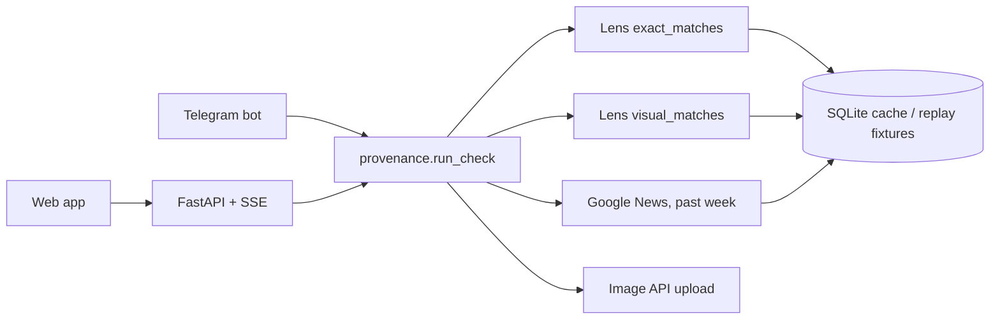

# First Seen

**Before you forward it, see where it's been.**

Drop in a photo from a WhatsApp forward. First Seen asks SerpApi's Google Lens API for
every page that carries it, dates each copy, and in about ten seconds answers:

1. **When was this photo first online?** The earliest date that several sites agree on.
2. **What has it been passed off as before?** Its "past lives": storms, places and events.
3. **Who has already debunked it?** Fact-checks of this photo or a stamped copy of it.
4. **Is the claimed event even in the news?** Google News from the past week.

It then writes a reply in **English and Hindi** to paste back into the group, as text or
an image card. A **Telegram bot** gives the same answer from your phone.

## One real check

The claim was *"Ahmedabad airport flooded today after heavy rain"*, and the photo is
Chennai airport on 2 December 2015. With live data from October 2026:

- **Online since at least December 2015.** The earliest well-attested copy is NDTV's from
  that day. There are 63 copies on 39 websites. Two pages dated March 2015 are ignored,
  because no other site backs those dates up.
- **Passed off before as** Cyclone Michaung, Hurricane Harvey and Houston.
- **Called out by** ABP News, News.com.au and the Coventry Telegraph.
- **Not in the news:** nothing from the past week matches the claim.

The other two examples:

- **"NASA's photo of India on Diwali night"**: online since at least October 2011, on 146
  websites. Fact-checked by BOOM and Fact Crescendo.
- **The flood shark**: online since at least August 2011, with titles in 6 scripts. Its
  past lives run Hurricane Irene → Houston → Harvey → Florence. Fact-checked by Snopes
  and Newschecker.

## Why this matters

Recycled photos are the cheapest misinformation: no editing skill needed, just a new
caption. India's fact-checkers debunk them by hand. They reverse-search, scroll the
results, guess at dates, then hunt for an earlier debunk to cite. First Seen does that in
one step, with a link for every claim it makes.

## How it uses SerpApi

| Step | API | What it gives First Seen | Searches |
|---|---|---|---|
| Exact copies | Google Lens API, `type=exact_matches`, `country=in` | up to ~400 pages showing the identical image, each with the date Google shows | 1 |
| Similar copies | Google Lens API, `type=visual_matches` | stamped, cropped and collaged versions, which is how fact-checkers republish a photo | 1 |
| The news now | Google Search API, `tbm=nws`, `tbs=qdr:w` | whether the claimed event is being reported this week | 1, only with a claim |
| Uploads | Image API | photos from a phone or WhatsApp that have no URL | 0 (we measured: uploads use no search credits) |

That's 3 searches per check. Responses are cached by image URL, or by the SHA-256 of the
uploaded bytes, so checking the same photo again costs nothing.

## How it decides

- **First seen** is the earliest date that 3 different sites back up within 30 days. The
  wording is "online since at least", so the date can understate a photo's age but never
  overstate it.
- **Past lives** are the storms, places and events named in each copy's title, grouped by
  year. Site-name suffixes are stripped first. This step is deterministic, so a replay
  gives the same answer.
- **Fact-checks** come from known desks (Indian IFCN signatories plus Snopes, AFP, Reuters
  and others) or from pages with debunk wording. Social posts are excluded, because a
  post saying "fake" is often the hoax itself.
- **Passed off as** lists the places and storms that debunks name, minus where the photo
  actually started.

Details and limits: [docs/method.md](docs/method.md).



## Run it

Backend, Python 3.11+ (PowerShell shown; on macOS/Linux use `source .venv/bin/activate`):

```
cd backend
uv venv; uv pip install -e ".[dev]"
copy .env.example .env        # set SERPAPI_API_KEY
.venv\Scripts\activate
uvicorn firstseen.api:app --port 8000
```

Web:

```
cd web
npm install
copy .env.example .env.local
npm run dev                   # http://localhost:3000
```

Telegram bot (optional): create a bot with @BotFather, put `TELEGRAM_BOT_TOKEN` in
`backend/.env`, then run `python -m firstseen.telegram_bot` from `backend/`.

### Without an API key

Set `SERPAPI_MODE=replay` in `backend/.env`. The three example buttons then run from the
recorded responses in `backend/fixtures/`, with no network calls and no key.

## Tests

```
cd backend
.venv\Scripts\python -m pytest
```

## What we tried first

We tested two other ideas against live SerpApi data before building, and dropped both.
The numbers are in [experiments/README.md](experiments/README.md).
