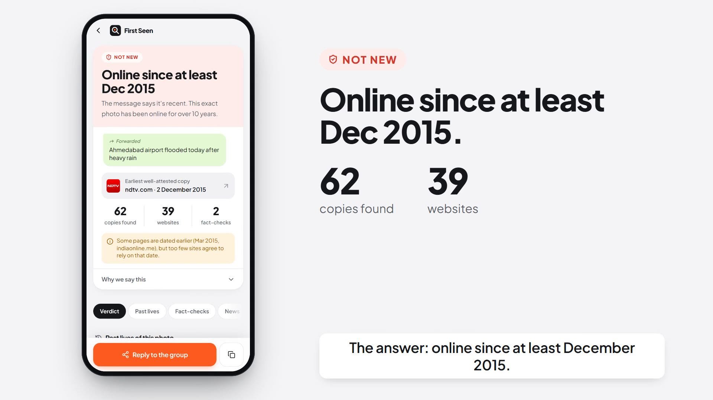
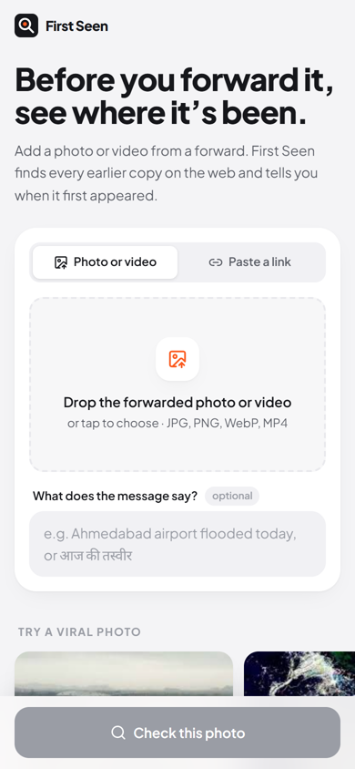
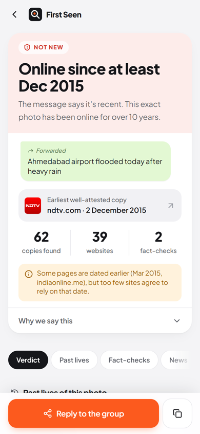
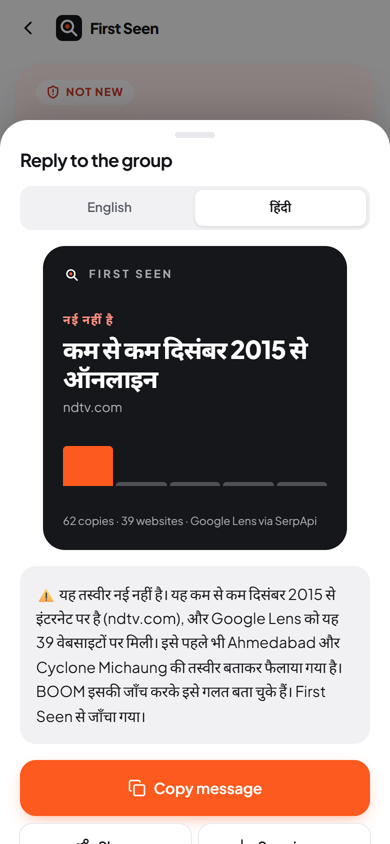
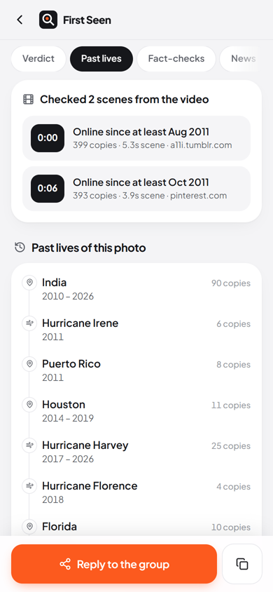
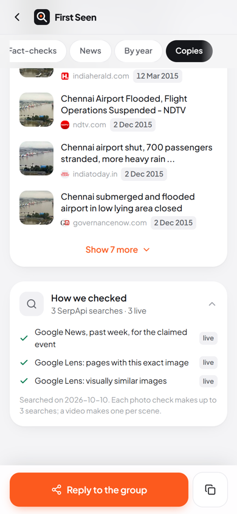
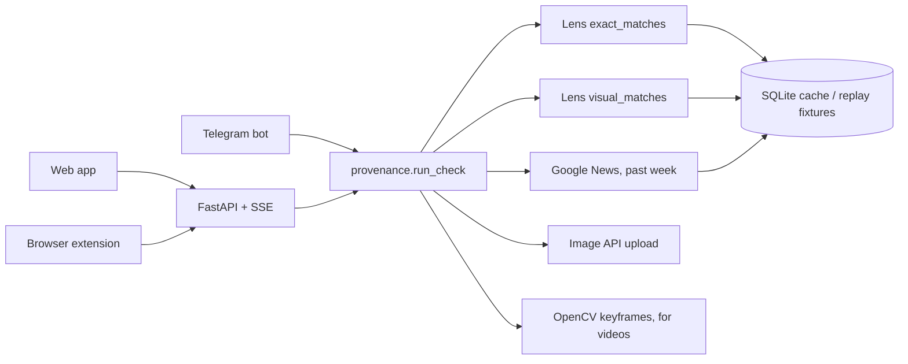

<div align="center">


# First Seen

**Before you forward it, see where it's been.**

A photo lands in the family WhatsApp group with "Ahmedabad airport flooded today".
First Seen finds every earlier copy of that exact photo on the web, dates them, and tells you
in about ten seconds that it's Chennai airport in December 2015.

SerpApi India Hackathon 2026 · Knowledge & Public Interest track

[Watch the demo](#demo) · [How it works](#how-it-uses-serpapi) · [Run it](#run-it) · [Method and limits](docs/method.md)

</div>

<a id="demo"></a>

<p align="center">
  <a href="docs/media/first-seen-demo.mp4"></a>
  <br>
  <sub><a href="docs/media/first-seen-demo.mp4">Demo video, 2:30, with sound</a>. The Chennai check in it is a live run: all three SerpApi searches are marked live.</sub>
</p>

## What it answers

Most viral photos aren't fake. They're old photos with a new caption, and checking takes
effort, so nobody checks. First Seen answers four questions about a photo or a video:

| Question | How First Seen answers it |
|---|---|
| When was it first online? | The earliest date that three different sites agree on |
| What has it been passed off as before? | The storms, places and events named by earlier copies and by debunks |
| Who has already debunked it? | Fact-checks of this photo, or of a stamped or cropped copy of it |
| Is the claimed event even in the news? | Google News from the past week, for the claim in the message |

Then it writes a short, calm reply in English or Hindi to paste back into the group, as text or
as an image card.

<table>
  <tr>
    <td align="center" width="20%"><br><sub>Upload, paste a link, or try an example</sub></td>
    <td align="center" width="20%"><br><sub>The verdict, with the copy it rests on</sub></td>
    <td align="center" width="20%"><br><sub>A reply for the group, in English or Hindi</sub></td>
    <td align="center" width="20%"><br><sub>Videos are dated scene by scene</sub></td>
    <td align="center" width="20%"><br><sub>Every SerpApi search, live or cached</sub></td>
  </tr>
</table>

## Three ways in

| | Where | How |
|---|---|---|
| Web app | `web/` | Upload a photo or video, or paste a link. The claim can be in English or Hindi. |
| Telegram bot | `backend/firstseen/telegram_bot.py` | Forward the photo or video to the bot. It replies with the verdict and a reply to copy. |
| Browser extension | `extension/` | Right-click any image, including on WhatsApp Web, and pick *Check with First Seen*. |

## One real check

The claim was *"Ahmedabad airport flooded today after heavy rain"*. Live data from
10 October 2026, as recorded in the demo:

- Online since at least 2 December 2015. The earliest well-attested copy is NDTV's, from the
  day the airport flooded. Google Lens found 62 copies on 39 websites, and 46 of the 50 dated
  copies are from 2015.
- Two pages say 12 March 2015, nine months before the flood. No other site backs that date, so
  First Seen sets it aside and says so on screen.
- It has been passed off as Cyclone Michaung, and as Ahmedabad airport once before. BOOM's
  fact-check, "How fake Ahmedabad airport flood pics made it to national dailies", turns up
  among the similar images.
- Nothing from the past week's news matches the claim.

The other two examples on the home screen:

- "NASA's photo of India on Diwali night" has been online since at least October 2011, on 146
  websites. BOOM and Fact Crescendo fact-checked it.
- The flood shark has been online since at least August 2011, with titles in 6 scripts. Its
  past lives run Hurricane Irene, then Houston, Harvey and Florence. Snopes and Newschecker
  fact-checked it.

## How it uses SerpApi

| Step | API and parameters | What First Seen gets | Searches |
|---|---|---|---|
| Exact copies | Google Lens API, `type=exact_matches`, `country=in` | Up to about 400 pages showing the identical image, each with the date Google shows | 1 |
| Similar copies | Google Lens API, `type=visual_matches` | Stamped, cropped and collaged versions. Fact-checkers republish photos this way. | 1 |
| The news now | Google Search API, `tbm=nws`, `tbs=qdr:w` | Whether the claimed event is being reported this week | 1, only with a claim |
| Uploads | Image API | A URL for photos from a phone or WhatsApp | 0 (uploads used no search credits when we measured) |

A photo check makes 3 searches, and all three run at once. A video makes one exact-match search
per scene, for up to 3 scenes. Responses are cached by image URL, or by the SHA-256 of the
uploaded bytes, so checking the same photo again costs nothing. The "How we checked" panel at
the bottom of every result lists each search and whether it ran live or came from the cache.

## How it decides

- **First seen** is the earliest date that 3 different sites back up within 30 days. The app
  says "online since at least", because the date can understate a photo's age but never
  overstate it.
- **Past lives** are the storms, places and events named in each copy's title, grouped by year.
  Site-name suffixes are stripped first. This step is deterministic, so a replay gives the same
  answer.
- **Fact-checks** come from known desks (the Indian IFCN signatories, plus Snopes, AFP, Reuters
  and others) or from pages with debunk wording. Social posts don't count, because a post
  saying "fake" is often the hoax itself.
- **Passed off as** lists the places and storms that debunks name, minus where the photo
  actually started.
- **Videos** are cut into scenes with OpenCV. A new scene needs both the colour histogram and
  the grayscale layout to change, so a codec glitch doesn't split a shot. Black bars are
  trimmed, and the sharpest frame of each of the 3 longest scenes is dated on its own. A
  slideshow of two old photos gets two dates.
- **Hindi claims** work too. आज, अभी and ताज़ा count as saying the photo is new.

The details, and what First Seen can get wrong, are in [docs/method.md](docs/method.md).



## Repository

```
backend/       FastAPI app, the provenance logic, the Telegram bot, tests
  firstseen/   provenance.py runs a check; dates.py, contexts.py and factcheck.py decide
  fixtures/    recorded SerpApi responses for replay mode
web/           Next.js app: home, live tracker, result page, reply sheet
extension/     Chrome extension (Manifest V3) for right-click checks
video/         The demo video, built in Remotion from screen recordings of the app
docs/          method.md (how it decides), demo scripts, README media
experiments/   The two ideas we tested against live data and dropped
scripts/       Fixture recording and cache seeding
```

## Run it

You need Python 3.11+ and Node 20+. PowerShell is shown; on macOS or Linux, use
`source .venv/bin/activate` and `cp`.

Backend:

```
cd backend
uv venv; uv pip install -e ".[dev]"
copy .env.example .env        # set SERPAPI_API_KEY
.venv\Scripts\activate
uvicorn firstseen.api:app --port 8000
```

Web app, in a second terminal:

```
cd web
npm install
copy .env.example .env.local
npm run dev                   # http://localhost:3000
```

Telegram bot (optional): create a bot with @BotFather, put `TELEGRAM_BOT_TOKEN` in
`backend/.env`, then run `python -m firstseen.telegram_bot` from `backend/`.

Browser extension (optional): load the `extension/` folder unpacked in Chrome. See
[extension/README.md](extension/README.md).

### Without an API key

Set `SERPAPI_MODE=replay` in `backend/.env`. The three examples on the home screen then run from
the recorded responses in `backend/fixtures/`, with no network calls and no key. The fixtures
were recorded on 8 October 2026, two days before the demo, so the Chennai replay shows 63 copies
where the live run found 62.

### Tests

```
cd backend
.venv\Scripts\python -m pytest
```

## The demo video

The video in `docs/media/` was made in code. Playwright drove the real app at phone size, and
Chrome's screencast recorded it. Remotion then laid out the scenes around those recordings
(`video/src/`). The voiceover is a Microsoft neural voice, generated per line with edge-tts.
The sound effects are CC0 recordings placed from the video's own timing and mixed with
[opus-sound-layer](https://github.com/Bodila51/opus-sound-layer). Credits are in
[video/audio/CREDITS.md](video/audio/CREDITS.md), and [video/README.md](video/README.md) explains
how to rebuild the video.

## What we tried first

We tested two other ideas against live SerpApi data before building this one, and dropped
both. A review-ring detector found no rings, only solicited reviews from throwaway accounts.
An Instagram counterfeit checker hit shops that post Reels, a Lens products mode that returns
nothing for India, and few INR prices. The numbers are in
[experiments/README.md](experiments/README.md).
